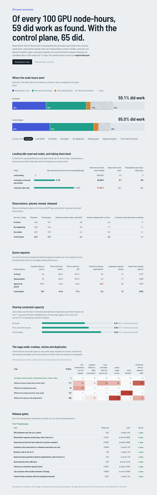

# gpu-quota-control-plane

Capacity reservations and quota management for a GPU cloud, measured against a simulated fleet whose truth the
control plane never sees.

- **Guaranteed reservations with a lifecycle**: requested → confirmed → active → expired, with a reclaim notice for
  reservations nobody starts (`gqc/domain.py`, `gqc/platform/reclaim.py`).
- **Lending and taking back**: idle reserved nodes go to preemptible jobs above a per-reservation forecast plus a
  learned buffer, and come back within one step (`gqc/platform/lending.py`).
- **Rebalancing**: flexible customers placed where the same GPU type has room; pending flexible reservations moved
  to make room, all or nothing (`gqc/platform/placement.py`).
- **Quota control**: quota requests scored from account signals and metering; modest low-risk ones approved at
  once, the rest to a person; contested preemptible capacity shared by weighted max-min fair share
  (`gqc/platform/quotas.py`, `gqc/platform/fairness.py`).
- **Consistency under failure**: a reservation is a saga across reservation, capacity and quota, each step one
  local transaction with a version check, messages through an outbox and an inbox, requests with an
  Idempotency-Key (`gqc/platform/saga.py`, `gqc/platform/store.py`), proven in a crash and concurrency lab
  (`gqc/lab/faults.py`) and served over HTTP on SQLite (`gqc/service/app.py`).



## Results

<!-- results:start -->
_Generated by `gqc report` from `reports/*.json`. Do not edit by hand._

3 simulated sites of 14 days, each 304 nodes of 8 GPUs across six clusters, about 46 reservation requests and 140 self-serve organisations. Numbers are the mean per site.

| | As found | Control plane |
|---|---:|---:|
| GPU utilisation | 59.1% | **65.0%** |
| Reserved nodes sitting idle (node-hours) | 17,000 | **8,949** |
| Reservation requests turned away | 15.7 | **12.3** |
| Reserved use there when the customer needed it | 100.000% | **99.968%** |
| Quota decision time, p90 | 50.7 h | **7.3 h** |
| Fairness on contested capacity (Jain) | 0.61 | **0.84** |
| Revenue per site (placeholder prices) | €1,451k | **€1,581k** |
| Crash-lab scenarios with a broken invariant | – | **0 of 300** |

<!-- results:end -->

The full tables, every ablation and each site are in [REPORT.md](REPORT.md).

## How it is measured

`gqc.world` generates six clusters (H100, H200 and B200, each in two regions), about 46 reservation contracts per
site with a usage profile per customer (steady, diurnal, bursty, ramping, starting days late, never used), 140
self-serve organisations of which some are abusive, and about 250 quota increase requests. Usage is revealed one
15-minute step at a time. Every design runs on the same sites with the same luck (ADR 0001):

| Design | What changes |
|---|---|
| As found | reserved nodes held idle, unused reservations kept, no moves, every quota request to an analyst, first come first served |
| Control plane | everything below switched on |
| Ablations | lend every idle node; lend nothing; no reclaim; no rebalancing; manual quotas; approve every quota; first come first served |

The crash and concurrency lab runs 300 scenarios per saga variant (600 held out): several clients reserve one
small cluster at once, requests are retried while the first call still runs, steps interleave at random, workers
die mid-step, the relay dies between sending and marking sent, and the broker delivers messages twice and out of
order. After everything settles, `check_invariants` looks for oversold capacity, reservations confirmed with no
capacity held, duplicate reservations for one request, reservations that never finished, wrong quota usage and
capacity held for dead reservations.

## Run it

```bash
pip install -e ".[dev]"
pytest -q
python -m gqc.cli dev            # every design and the crash lab on the development sites, then the reports
python -m gqc.cli gate dev       # exit 1 unless every gate passes
python -m gqc.cli serve          # the API on :8080 (or: docker build -t gqc . && docker run -p 8080:8080 gqc)
cd web && npm ci && npm run dev  # the console
```

```bash
curl -X PUT localhost:8080/v1/capacity/eu-north1-h200 -H 'content-type: application/json' -d '{"nodes": 48}'
curl -X PUT localhost:8080/v1/quotas/acme/eu-north1-h200 -H 'content-type: application/json' -d '{"nodes": 16}'
curl -X POST localhost:8080/v1/reservations -H 'content-type: application/json' -H 'Idempotency-Key: order-7781' \
     -d '{"org": "acme", "cluster": "eu-north1-h200", "nodes": 8}'
```

## Limits

- **The fleet, the customers and the abuse are simulated.** Usage profiles, notice answers, review accuracy and the
  abuse signals are generated; prices are placeholders. Real reservations are probably burstier in ways this
  generator does not know.
- **One step to take a node back.** Preempting a job and handing the node over is modelled as one 15-minute step;
  checkpoint time, draining and node health are not modelled.
- **Billing starts at the first use** in this simulation; contracts that bill from the start date would change the
  revenue numbers, not the utilisation ones.
- **The reservation ledger is per cluster and per step**; topology (racks, NVLink domains, InfiniBand islands) is not
  modelled, so a placement here is coarser than a real scheduler's.
- **The saga runs in one process in the lab and on SQLite in the API.** Interleavings, crashes and duplicate
  deliveries are injected deterministically; network partitions, clock skew and a real broker are not.
- **The quota score is a weighted rule, not a trained model.** A disguised abusive organisation with an old, paying
  account and normal usage would be approved.
- Built in my own project time, not yet run at an employer.

## Repository

`AGENTS.md` (invariants and the held-out rule), `SKILLS.md` (repeatable tasks), `docs/adr/` (decisions),
`config/` (every setting and gate), `reports/` (generated results), `web/` (React console with Framer Motion).
